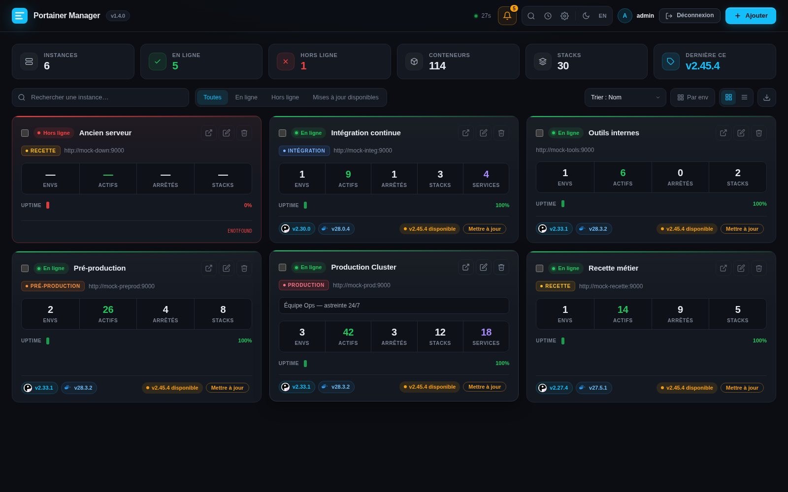
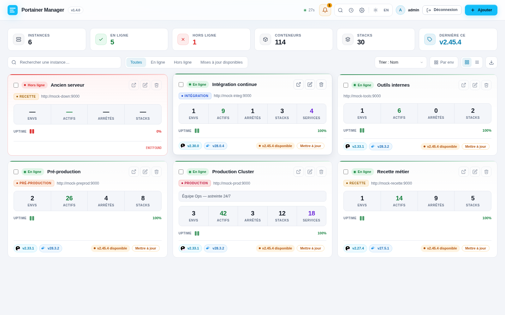
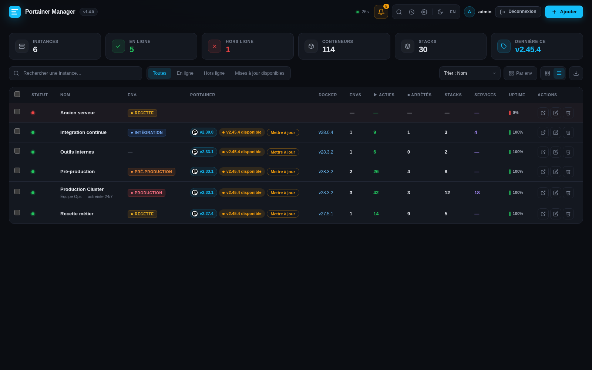
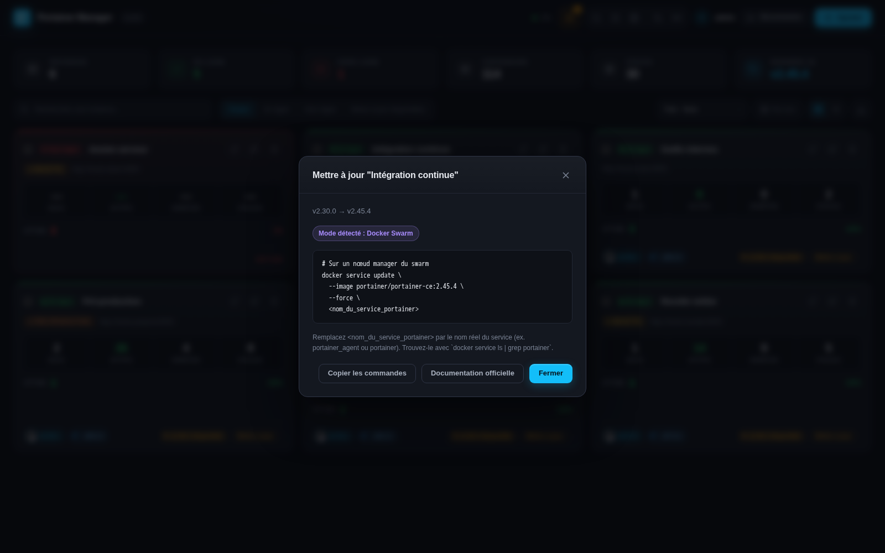
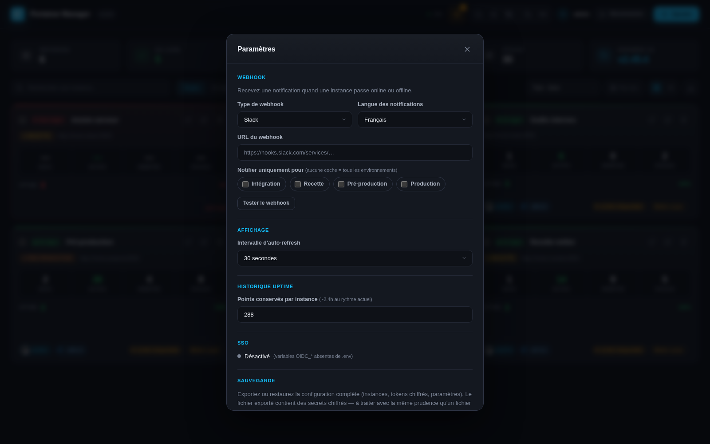
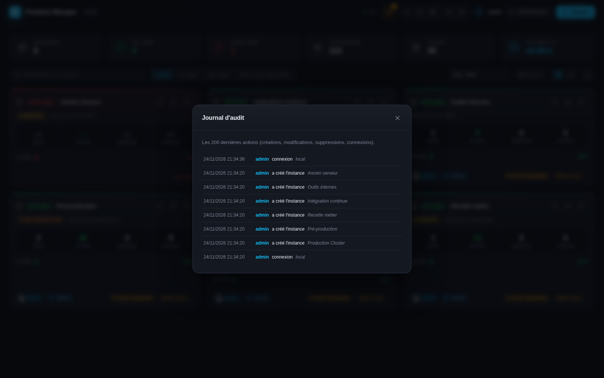
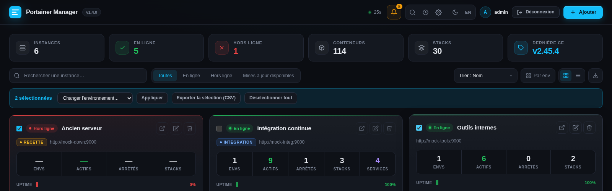
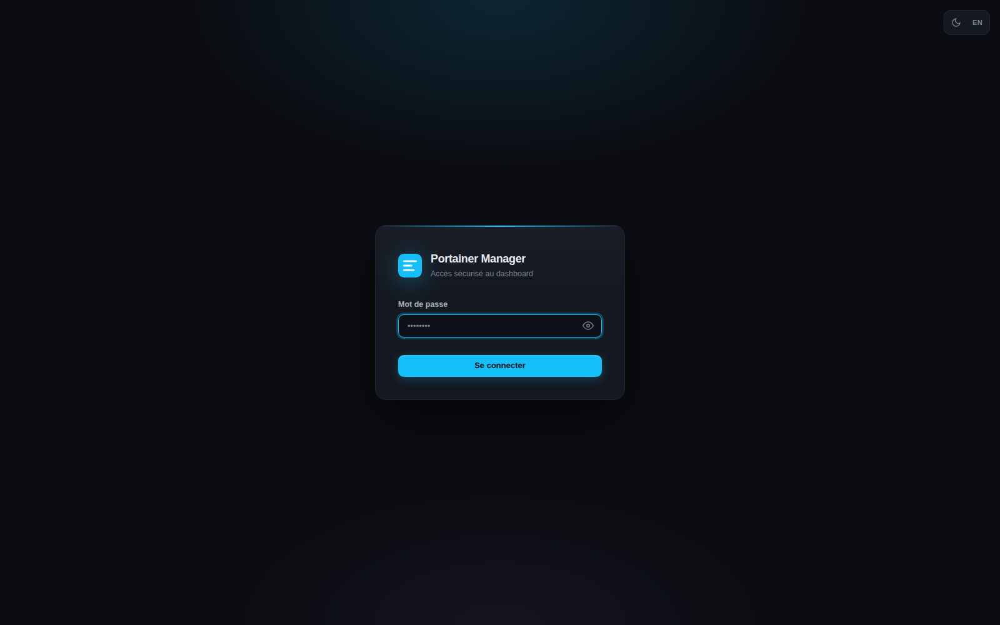

# Portainer Manager

[](https://github.com/ThePharaohOps/portainer-manager/tags)
[](https://github.com/ThePharaohOps/portainer-manager/actions/workflows/ci.yml)
[](LICENSE)
[](Dockerfile)

🇬🇧 [Read in English](README.md)

Dashboard web sécurisé pour gérer plusieurs instances Portainer depuis une interface unique.

L'interface est disponible en **français et en anglais** (choisie selon la langue du navigateur, modifiable avec le bouton FR/EN), avec un thème **sombre, clair ou automatique**.

## Aperçu

> Noms et URLs anonymisés dans ces captures — l'interface réelle affiche vos propres instances.

**Vue grille**


**Thème clair**


**Vue liste**


**Guide de mise à jour**


**Paramètres**


**Journal d'audit**


**Actions groupées**


**Connexion**


## Fonctionnalités

### Dashboard
- Stats globales : instances totales, en ligne, hors ligne, conteneurs, stacks, dernière version CE
- **Alerte cloche** : liste des instances Portainer à mettre à jour, triées de la plus ancienne version à la plus récente
- **Auto-refresh** toutes les 30 secondes avec compte à rebours visible

### Gestion des instances
- **Ajout** via URL + API Token uniquement (pas de login/mot de passe Portainer)
- **Modification** : nom, URL, token, environnement, notes
- **Suppression** avec confirmation
- **Bouton "Ouvrir"** pour accéder directement à l'instance Portainer

### Cards
- Statut en ligne / hors ligne avec bordure colorée (vert/rouge)
- Badge d'**environnement** coloré : Intégration, Recette, Pré-production, Production
- Métriques : environnements, conteneurs actifs/arrêtés, stacks, services Swarm
- Versions **Portainer** et **Docker** avec logos
- Badge **"À jour"** ou **"vX.X.X disponible"** par comparaison avec la dernière CE
- Bouton **"Mettre à jour"** sur les instances obsolètes : ouvre une popup avec les commandes adaptées (Docker standalone ou Swarm, détecté automatiquement)
- **Notes** libres affichées sur la card
- **Uptime sparkline** : historique des 288 dernières vérifications (~2.4h) avec pourcentage

### Vues et navigation
- **Vue grille** (défaut) ou **vue liste** (tableau dense)
- **Groupement par environnement** : sections Production / Pré-production / Recette / Intégration
- **Tri** : par nom, environnement, statut, version, date d'ajout
- **Recherche** par nom ou URL
- **Recherche globale** (icône 🔍) : cherche un conteneur ou une stack par son nom **à travers toutes les instances**, résultats groupés par instance avec lien direct vers Portainer — voir [Recherche globale](#recherche-globale)
- **Filtre** : Toutes / En ligne / Hors ligne / Mises à jour disponibles
- **Export CSV** de l'état complet du parc
- **Actions groupées** (admin) : sélectionner plusieurs instances pour changer leur environnement en masse ou exporter uniquement la sélection en CSV

### Langue et thème
- Interface **français / anglais** : détectée selon la langue du navigateur à la première visite, puis modifiable à tout moment avec le bouton **FR/EN** (en-tête et page de connexion). Le choix est mémorisé par navigateur
- Thème **sombre** (par défaut), **clair** ou **automatique** (suit le système d'exploitation), via le bouton soleil/lune
- Les exports CSV, les dates et le journal d'audit suivent la langue choisie

### Rôles et audit
- **Rôle lecture seule (viewer)** optionnel via un claim/groupe OIDC : masque Ajouter/Modifier/Supprimer, Paramètres, Audit et les actions groupées — voir [Rôles admin/viewer (OIDC)](#rôles-adminviewer-oidc)
- **Journal d'audit** (admin) : historique des créations/modifications/suppressions d'instances, changements de configuration, imports de sauvegarde et connexions — qui a fait quoi et quand
- **Page de statut publique** en lecture seule, sans authentification (`/status`) : uniquement le nombre d'instances en ligne/hors ligne, sans détail sensible — pratique pour un écran mural
- **Endpoint Prometheus** (`/metrics`) : statut, conteneurs actifs/arrêtés, stacks, uptime et disponibilité de mise à jour par instance, au format d'exposition Prometheus — voir [Endpoint Prometheus](#endpoint-prometheus)

### Alertes webhook
- Notification automatique quand une instance change de statut (online ↔ offline)
- Support : **Slack**, **Microsoft Teams**, **Generic JSON**
- **Filtre par environnement** : notifier uniquement Production, par exemple (aucune coche = tous)
- **Langue des notifications** : français (par défaut) ou anglais
- Bouton "Tester" dans les paramètres

### Paramètres (bouton ⚙️)
- **Webhook** : type, URL, filtre par environnement, test
- **Affichage** : intervalle d'auto-refresh (15s / 30s / 1min / 5min)
- **Historique uptime** : nombre de points conservés par instance (remplace la constante fixe de 288)
- **Statut SSO** : activé/désactivé, fournisseur, lien de test rapide
- **Sauvegarde** : export/import JSON de la configuration complète (instances + tokens chiffrés + réglages) — voir [Sauvegarde et restauration](#sauvegarde-et-restauration)

### Sécurité
- **Authentification** par mot de passe partagé, avec session 8h persistée sur disque (`data/sessions/`) : un redémarrage du conteneur ne déconnecte pas les sessions actives
- **Protection contre le brute-force** : après 10 échecs de mot de passe (`LOGIN_MAX_ATTEMPTS`) depuis une même IP, la connexion par mot de passe est bloquée 15 minutes pour cette IP (le SSO reste disponible). Les échecs et blocages apparaissent dans le journal d'audit avec l'IP du client
- **Sessions durcies** : nouvel identifiant de session à chaque connexion (pas de fixation de session), cookie `HttpOnly` + `SameSite=Lax` (`Secure` automatiquement en HTTPS), comparaison du mot de passe en temps constant
- **En-têtes de sécurité** : Content-Security-Policy stricte (aucun script inline), `X-Frame-Options: DENY` (pas de clickjacking), `X-Content-Type-Options: nosniff`, `Referrer-Policy`
- **SSO / OIDC** optionnel (Azure AD/Entra ID, Okta, Keycloak, Google Workspace, Authentik...) : se superpose au mot de passe local, qui reste toujours disponible en secours — voir [Configurer le SSO (OIDC)](#configurer-le-sso-oidc)
- **Tokens API chiffrés au repos** (AES-256-GCM, clé dérivée de `SESSION_SECRET`) dans `data/instances.json`
- Les tokens API ne sont **jamais** transmis au navigateur
- Les appels vers l'API Portainer sont effectués côté serveur uniquement
- Certificats TLS auto-signés acceptés (fréquent en local)

---

## Prérequis

- **Docker** (recommandé) — l'image utilise `node:24-alpine` (dernière LTS active) et embarque un `HEALTHCHECK` (`docker ps` reflète l'état réel de l'app, utile derrière Swarm/Kubernetes/Traefik)
- **ou** Node.js 18+ en local (minimum imposé par Express 5)

---

## Démarrage rapide

### Avec l'image prête à l'emploi (le plus rapide)

Chaque version est publiée sur le GitHub Container Registry pour `linux/amd64` et `linux/arm64` (Raspberry Pi, Apple Silicon...), à partir de la v1.4.0 :

```bash
docker run -d --name portainer-manager --restart unless-stopped \
  -p 3000:3000 \
  -e ADMIN_PASSWORD=a-changer \
  -e SESSION_SECRET=une-chaine-aleatoire-longue-et-unique \
  -v portainer-manager-data:/app/data \
  ghcr.io/thepharaohops/portainer-manager:latest
```

Générez `SESSION_SECRET` une seule fois (ex. `openssl rand -base64 32`) et conservez-le : il chiffre aussi les tokens API enregistrés. Tags disponibles : `latest`, une version exacte (`1.4.0`) ou une ligne mineure (`1.4`).

Avec Docker Compose, remplacez `build: .` par `image: ghcr.io/thepharaohops/portainer-manager:latest` dans `docker-compose.yml`.

### Construire depuis les sources avec Docker

```bash
# Copier et configurer les variables
cp .env.example .env   # ou éditer .env directement

docker compose up -d
```

### En local (Node.js)

```bash
npm install
npm start
```

En développement, `npm run dev` redémarre le serveur automatiquement à chaque modification (`--watch` intégré à Node, sans dépendance supplémentaire).

L'application est accessible sur **http://localhost:3000** (ou l'IP définie dans `HOST_IP`).

---

## Configuration — fichier `.env`

| Variable         | Défaut                        | Description                              |
|------------------|-------------------------------|------------------------------------------|
| `PORT`           | `3000`                        | Port d'écoute du serveur                 |
| `HOST_IP`        | *(toutes les interfaces)*     | IP affichée au démarrage dans les logs   |
| `ADMIN_PASSWORD` | `admin`                       | ⚠️ Mot de passe du dashboard — à changer |
| `SESSION_SECRET` | *(aléatoire à chaque restart)*| Clé de signature des sessions et de chiffrement des tokens API |
| `TRUST_PROXY`    | *(non défini)*                | `1` derrière un reverse proxy (voir [Mettre l'application derrière un reverse proxy](#mettre-lapplication-derrière-un-reverse-proxy)) |
| `LOGIN_MAX_ATTEMPTS` | `10`                      | Échecs de mot de passe tolérés par IP avant un blocage de 15 minutes |
| `DATA_DIR`       | `./data`                      | Dossier des instances, réglages, sessions et du journal d'audit |

> **Important** : sans `SESSION_SECRET` fixe, les sessions sont invalidées **et les tokens API chiffrés deviennent illisibles** à chaque redémarrage.

Exemple de `.env` :

```env
HOST_IP=192.168.1.100
ADMIN_PASSWORD=MonMotDePasseSecurisé
SESSION_SECRET=une-chaine-aleatoire-longue-et-unique
PORT=3000
```

---

## Configurer le SSO (OIDC)

En plus du mot de passe partagé, l'application peut déléguer l'authentification à n'importe quel fournisseur **OpenID Connect** (Azure AD/Entra ID, Okta, Keycloak, Google Workspace, Authentik, etc.) via `openid-client`. Le mot de passe local **reste toujours actif** en secours, même si le SSO est configuré.

| Variable              | Défaut                | Description                                                        |
|------------------------|------------------------|----------------------------------------------------------------------|
| `OIDC_ISSUER_URL`       | *(désactivé si vide)* | URL de l'issuer OIDC (découverte via `/.well-known/openid-configuration`) |
| `OIDC_CLIENT_ID`        |                        | Client ID enregistré auprès du fournisseur                          |
| `OIDC_CLIENT_SECRET`    |                        | Client secret correspondant                                         |
| `OIDC_REDIRECT_URI`     |                        | URL de callback, doit être **exactement** celle enregistrée chez le fournisseur (ex. `https://portainer-manager.example.com/auth/oidc/callback`) |
| `OIDC_SCOPE`            | `openid profile email`| Scopes demandés                                                     |
| `OIDC_DISPLAY_NAME`     | `SSO`                  | Libellé du bouton sur la page de connexion (ex. `Entra ID`, `Okta`) |
| `OIDC_ALLOW_INSECURE`   | `false`                | `true` pour autoriser un issuer en HTTP ou avec certificat auto-signé — **dev/test uniquement**, jamais en production |

Les trois variables `OIDC_ISSUER_URL`, `OIDC_CLIENT_ID` et `OIDC_CLIENT_SECRET` (+ `OIDC_REDIRECT_URI`) sont **toutes requises** pour activer le SSO ; si l'une manque, seul le mot de passe local est proposé.

### Exemple — Keycloak
```env
OIDC_ISSUER_URL=https://keycloak.example.com/realms/mon-realm
OIDC_CLIENT_ID=portainer-manager
OIDC_CLIENT_SECRET=xxxxxxxx
OIDC_REDIRECT_URI=https://portainer-manager.example.com/auth/oidc/callback
OIDC_DISPLAY_NAME=Keycloak
```

### Exemple — Azure AD / Entra ID
```env
OIDC_ISSUER_URL=https://login.microsoftonline.com/<tenant-id>/v2.0
OIDC_CLIENT_ID=xxxxxxxx-xxxx-xxxx-xxxx-xxxxxxxxxxxx
OIDC_CLIENT_SECRET=xxxxxxxx
OIDC_REDIRECT_URI=https://portainer-manager.example.com/auth/oidc/callback
OIDC_DISPLAY_NAME=Entra ID
```

Dans les deux cas, il faut déclarer `OIDC_REDIRECT_URI` comme URI de redirection autorisée côté fournisseur (type "Web"/"Authorization Code").

> Derrière un reverse proxy, la valeur exacte d'`OIDC_REDIRECT_URI` est toujours utilisée pour l'échange du code (indépendamment de ce que le proxy transmet comme en-tête `Host`) — pas besoin de configurer `trust proxy` pour que le SSO fonctionne. Si vous obtenez `invalid_grant` / "Incorrect redirect_uri" (Keycloak) ou équivalent malgré tout, vérifiez d'abord que la valeur d'`OIDC_REDIRECT_URI` correspond **caractère pour caractère** à l'URI enregistrée côté fournisseur.

> **Pourquoi pas LDAP ?** La seule bibliothèque LDAP viable pour Node.js (`ldapjs`, et tout ce qui en dépend comme `passport-ldapauth`) a été [officiellement décommissionnée](https://github.com/ldapjs/node-ldapjs) par son mainteneur, sans successeur maintenu. OIDC est privilégié car activement maintenu et couvre la quasi-totalité des annuaires d'entreprise modernes (y compris Active Directory via ADFS ou Entra ID).

---

## Rôles admin/viewer (OIDC)

Par défaut, tout utilisateur authentifié (mot de passe local ou SSO) a un accès complet (**admin**). Il est possible de restreindre les utilisateurs SSO à un rôle **viewer** (lecture seule) selon un claim/groupe renvoyé par le fournisseur OIDC. Le mot de passe local reste toujours **admin**, quel que soit ce réglage.

| Variable          | Défaut     | Description                                                                 |
|-------------------|------------|-------------------------------------------------------------------------------|
| `OIDC_ROLE_CLAIM`  | `groups`   | Nom du claim ID Token contenant les groupes/rôles de l'utilisateur           |
| `OIDC_ADMIN_GROUP` | *(aucun)*  | Valeur du claim qui donne le rôle admin. Si absent, **tous les utilisateurs SSO sont admin** (comportement actuel inchangé) |

Exemple — seuls les membres du groupe `portainer-admins` (Keycloak, Entra ID...) sont admin, les autres utilisateurs SSO sont en lecture seule :
```env
OIDC_ROLE_CLAIM=groups
OIDC_ADMIN_GROUP=portainer-admins
```

Ce que le rôle **viewer** ne peut pas faire (masqué côté interface **et** rejeté côté API — 403) :
- Ajouter / modifier / supprimer une instance, actions groupées
- Accéder aux Paramètres (webhook, rétention, export/import) et au Journal d'audit

---

## Recherche globale

Le bouton 🔍 dans l'en-tête ouvre une recherche par nom de conteneur ou de stack **à travers toutes les instances configurées**, pas seulement par nom/URL d'instance. Accessible aux admins et aux viewers (lecture seule).

- Route : `GET /api/search?q=<terme>` (2 caractères minimum)
- Pour chaque instance, interroge en parallèle la liste des stacks et, pour chaque environnement Docker, la liste des conteneurs (`GET /api/endpoints/{id}/docker/containers/json?all=true` côté Portainer) — les instances injoignables sont simplement ignorées, pas d'erreur bloquante
- Résultats groupés par instance, avec lien direct pour l'ouvrir dans Portainer

> Contrairement au reste du dashboard, cette recherche n'est **pas** automatique : elle n'est déclenchée qu'à la demande (bouton "Rechercher"), pour éviter de solliciter toutes les instances à chaque frappe ou à chaque cycle d'auto-refresh.

---

## Endpoint Prometheus

`GET /metrics` expose au format d'exposition Prometheus les métriques déjà collectées par le dashboard : pas de sondage supplémentaire des instances Portainer, juste la dernière donnée connue (alimentée par les mêmes requêtes que l'auto-refresh de l'interface — mêmes limites de fraîcheur que la [page de statut publique](#rôles-et-audit), qui dépend d'au moins un onglet ouvert quelque part).

| Métrique | Description |
|---|---|
| `portainer_manager_app_info{version}` | Toujours à 1, `version` = version de l'app |
| `portainer_manager_instances_total` | Nombre total d'instances configurées |
| `portainer_manager_instance_up{instance,environment}` | 1 si joignable, 0 sinon |
| `portainer_manager_instance_containers_running{instance,environment}` | Conteneurs actifs |
| `portainer_manager_instance_containers_stopped{instance,environment}` | Conteneurs arrêtés |
| `portainer_manager_instance_stacks{instance,environment}` | Nombre de stacks |
| `portainer_manager_instance_uptime_ratio{instance,environment}` | Disponibilité sur l'historique conservé (0 à 1) |
| `portainer_manager_instance_portainer_outdated{instance,environment}` | 1 si une mise à jour Portainer est disponible |

**Authentification** : par défaut, `/metrics` nécessite une session authentifiée (comme le reste du dashboard) — pratique pour tester avec `curl -b cookies.txt`, mais peu adapté à un scraper Prometheus. Définissez `METRICS_TOKEN` dans `.env` pour activer un accès par jeton, sans session :

```env
METRICS_TOKEN=un-jeton-long-et-aleatoire
```

```yaml
# prometheus.yml
scrape_configs:
  - job_name: portainer-manager
    metrics_path: /metrics
    bearer_token: un-jeton-long-et-aleatoire
    static_configs:
      - targets: ['portainer-manager.example.com']
```

---

## Mettre l'application derrière un reverse proxy

L'app écoute en HTTP simple sur le port interne défini par `PORT` (3000 par défaut), exposé côté hôte via le mapping défini dans `docker-compose.yml` (ex. `127.0.0.1:3001:3000`). Un reverse proxy permet d'ajouter un nom de domaine et le TLS/HTTPS devant.

Dans tous les cas :
- Adaptez `proxy_pass` / `reverse_proxy` au port réellement exposé côté hôte (celui de `ports:` dans `docker-compose.yml`, pas forcément 3000).
- Définissez **`TRUST_PROXY=1`** (un proxy devant l'app). L'app lit alors la vraie IP du client dans `X-Forwarded-For`. Sans ça, tous les utilisateurs semblent venir de l'IP du proxy : la limite anti brute-force les compterait comme un seul client, et 10 mauvais mots de passe tapés par n'importe qui bloqueraient la connexion par mot de passe pour tout le monde pendant 15 minutes (le SSO continue de fonctionner). Avec `TRUST_PROXY` défini et un proxy qui transmet `X-Forwarded-Proto: https`, le cookie de session est aussi marqué `Secure`.
- Pensez à garder `SESSION_SECRET` fixe dans `.env` (voir plus haut).

### Nginx

```nginx
server {
    listen 443 ssl;
    server_name portainer-manager.example.com;

    ssl_certificate     /etc/letsencrypt/live/portainer-manager.example.com/fullchain.pem;
    ssl_certificate_key /etc/letsencrypt/live/portainer-manager.example.com/privkey.pem;

    location / {
        proxy_pass http://127.0.0.1:3001;
        proxy_set_header Host              $host;
        proxy_set_header X-Real-IP         $remote_addr;
        proxy_set_header X-Forwarded-For   $proxy_add_x_forwarded_for;
        proxy_set_header X-Forwarded-Proto $scheme;
    }
}
```

### Caddy

Le TLS est géré automatiquement (Let's Encrypt) — pas de config manuelle des certificats.

```caddyfile
portainer-manager.example.com {
    reverse_proxy 127.0.0.1:3001
}
```

### Traefik

Si Traefik tourne déjà via Docker sur le même hôte, ajoutez ces labels au service dans `docker-compose.yml` (et retirez le mapping `ports:` si Traefik doit être le seul point d'entrée) :

```yaml
services:
  portainer-manager:
    # ... reste de la config inchangé ...
    labels:
      - "traefik.enable=true"
      - "traefik.http.routers.portainer-manager.rule=Host(`portainer-manager.example.com`)"
      - "traefik.http.routers.portainer-manager.entrypoints=websecure"
      - "traefik.http.routers.portainer-manager.tls.certresolver=letsencrypt"
      - "traefik.http.services.portainer-manager.loadbalancer.server.port=3000"
    networks:
      - traefik-public

networks:
  traefik-public:
    external: true
```

### Apache

Nécessite les modules `proxy` et `proxy_http` (`a2enmod proxy proxy_http` puis reload).

```apache
<VirtualHost *:443>
    ServerName portainer-manager.example.com

    SSLEngine on
    SSLCertificateFile      /etc/letsencrypt/live/portainer-manager.example.com/fullchain.pem
    SSLCertificateKeyFile   /etc/letsencrypt/live/portainer-manager.example.com/privkey.pem

    ProxyPreserveHost On
    ProxyPass        / http://127.0.0.1:3001/
    ProxyPassReverse / http://127.0.0.1:3001/
    RequestHeader set X-Forwarded-Proto "https"
</VirtualHost>
```

---

## Créer un API Token Portainer

1. Connectez-vous à votre instance Portainer
2. Cliquez sur votre nom d'utilisateur en haut à droite → **Mon compte**
3. Section **Access tokens** → **Add access token**
4. Donnez un nom, copiez le token généré (format `ptr_…`)

---

## Développement et tests

```bash
npm install
npm run dev   # redémarrage automatique à chaque modification
npm test      # tests API, sécurité et traductions (test runner intégré à Node)
```

Les tests démarrent le vrai serveur dans un dossier de données temporaire, avec une fausse API Portainer : ils ne touchent jamais à votre dossier `data/` ni à votre `.env`. Ils couvrent la connexion, le blocage anti brute-force, les sessions, les en-têtes de sécurité, la gestion des instances et le chiffrement des tokens, les données live, la recherche globale, `/metrics`, et la complétude des traductions français/anglais (chaque clé utilisée dans les pages doit exister dans les deux langues).

GitHub Actions lance les tests, un audit des dépendances de production et un build Docker + healthcheck à chaque push et pull request. Pousser un tag `vX.Y.Z` publie l'image multi-architecture sur GHCR.

---

## Structure du projet

```
portainer-manager/
├── server.js              # Backend Express (API, proxy Portainer, auth OIDC, webhook, uptime)
├── package.json
├── Dockerfile
├── docker-compose.yml
├── LICENSE                # GPL-3.0
├── CHANGELOG.md
├── README.md              # Ce fichier existe aussi en anglais (par défaut) et en français (README.fr.md)
├── .env                   # Variables d'environnement (ne pas committer)
├── .github/workflows/     # CI (tests, audit, build Docker) et publication de l'image
├── test/                  # Tests automatisés (npm test)
├── screenshots/           # Captures en anglais (en français dans screenshots/fr/)
├── data/
│   ├── instances.json     # Instances sauvegardées, tokens chiffrés (créé automatiquement)
│   ├── config.json        # Config webhook, filtre environnements, rétention uptime (créé automatiquement)
│   ├── uptime.json        # Historique uptime (créé automatiquement)
│   ├── audit.log          # Journal d'audit, JSONL append-only (créé automatiquement)
│   └── sessions/          # Sessions persistées sur disque (créé automatiquement)
└── public/
    ├── index.html         # Dashboard principal
    ├── login.html         # Page de connexion (+ login.js)
    ├── status.html        # Page de statut publique, sans authentification (+ status.js)
    ├── i18n.js            # Traductions français/anglais
    ├── theme.js           # Thème sombre/clair/automatique
    ├── style.css
    └── app.js
```

---

## API REST

Les erreurs sont renvoyées sous la forme `{"error": "<message>", "code": "<code>"}`. Le `code` est stable (ex. `bad_password`, `too_many_attempts`, `duplicate_url`, `not_found`) et c'est lui que l'interface traduit. Une connexion bloquée répond `429` avec un en-tête `Retry-After`.

### Auth
| Méthode | Route                  | Description                      |
|---------|------------------------|----------------------------------|
| POST    | `/api/auth/login`      | Connexion locale `{password}`    |
| POST    | `/api/auth/logout`     | Déconnexion                      |
| GET     | `/api/auth/me`         | Utilisateur connecté (`{username, method, role}` ou `null`) |
| GET     | `/api/auth/methods`    | Méthodes de connexion disponibles (`{local, oidc, oidcLabel}`) |
| GET     | `/auth/oidc/login`     | Redirige vers le fournisseur OIDC |
| GET     | `/auth/oidc/callback`  | Callback OIDC (échange du code, création de session) |

### Instances (admin)
| Méthode | Route                        | Description                                        |
|---------|------------------------------|----------------------------------------------------|
| GET     | `/api/instances`             | Liste toutes les instances (sans token) — admin et viewer |
| POST    | `/api/instances`             | Ajouter `{name, url, token, environment, notes}`   |
| PUT     | `/api/instances/:id`         | Modifier `{name, url, token, environment, notes}`  |
| DELETE  | `/api/instances/:id`         | Supprimer une instance                             |
| GET     | `/api/instances/:id/data`    | Données live depuis l'API Portainer — admin et viewer |

### Divers
| Méthode | Route                          | Description                            |
|---------|--------------------------------|----------------------------------------|
| GET     | `/api/uptime`                  | Historique uptime par instance — admin et viewer |
| GET     | `/api/config`                  | Configuration (webhook, langue des notifications, filtre environnements, rétention uptime) — admin |
| PUT     | `/api/config`                  | Modifier la configuration — admin      |
| POST    | `/api/config/test-webhook`     | Tester un webhook — admin              |
| GET     | `/api/portainer/latest-version`| Dernière version CE (cache 1h)         |
| GET     | `/api/app/version`             | Version de l'app et dernière version disponible sur GitHub (`{current, latest}`, cache 1h) |
| GET     | `/api/backup/export`           | Exporter la configuration complète (JSON) — admin |
| POST    | `/api/backup/import`           | Importer une sauvegarde (upsert par id/URL) — admin |
| GET     | `/api/audit`                   | 200 dernières entrées du journal d'audit — admin |
| GET     | `/status`                      | Page de statut publique, sans authentification |
| GET     | `/api/status/public`           | Compteurs agrégés `{total, online, offline, unknown}`, sans authentification |
| GET     | `/metrics`                     | Métriques Prometheus — session ou `METRICS_TOKEN`, voir [Endpoint Prometheus](#endpoint-prometheus) |
| GET     | `/api/search`                  | Recherche de conteneurs/stacks par nom à travers toutes les instances (`?q=`) — admin et viewer |

---

## Sauvegarde et restauration

Le bouton **⚙️ Paramètres → Sauvegarde** exporte un fichier JSON contenant toutes les instances (avec leurs tokens **chiffrés**, pas en clair) et les réglages (webhook, filtre environnements, rétention uptime).

- **Export** : `GET /api/backup/export`, déclenche le téléchargement d'un fichier `portainer-manager-backup-AAAA-MM-JJ.json`.
- **Import** : `POST /api/backup/import` avec le même format. Les instances sont **fusionnées** par `id` puis par `url` (mise à jour si une correspondance existe, création sinon) — rien n'est supprimé automatiquement. Un token déjà présent est réutilisé si le fichier importé n'en fournit pas.

> ⚠️ Les tokens restent **chiffrés** dans le fichier exporté (AES-256-GCM), mais ce fichier doit être traité comme un secret : il ne redevient lisible qu'avec le `SESSION_SECRET` de l'instance qui l'a généré, mais autant le stocker comme n'importe quel export de credentials.

### Restaurer sur une autre machine

Pour migrer vers une nouvelle installation (nouveau serveur, deuxième PC...), **copiez le `SESSION_SECRET` de l'installation d'origine dans le `.env` de la nouvelle** avant d'importer la sauvegarde. Sans ça, les instances apparaîtront bien dans le tableau (les métadonnées ne sont pas chiffrées), mais chaque token restera indéchiffrable — carte "Hors ligne" avec l'erreur `Token illisible (SESSION_SECRET incorrect)`, et une ligne `[crypto] Token illisible pour "…"` dans les logs.

Si ça arrive après coup : pas besoin de tout réimporter, il suffit de corriger `SESSION_SECRET` dans le `.env` de la nouvelle machine puis de redémarrer le conteneur (`docker compose up -d`) — les tokens déjà importés redeviennent lisibles immédiatement, la clé de chiffrement étant la seule chose qui manquait.

---

## Licence

[GPL-3.0](LICENSE)
